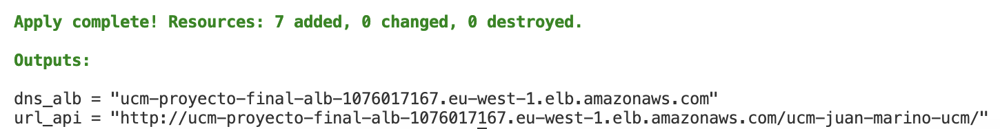
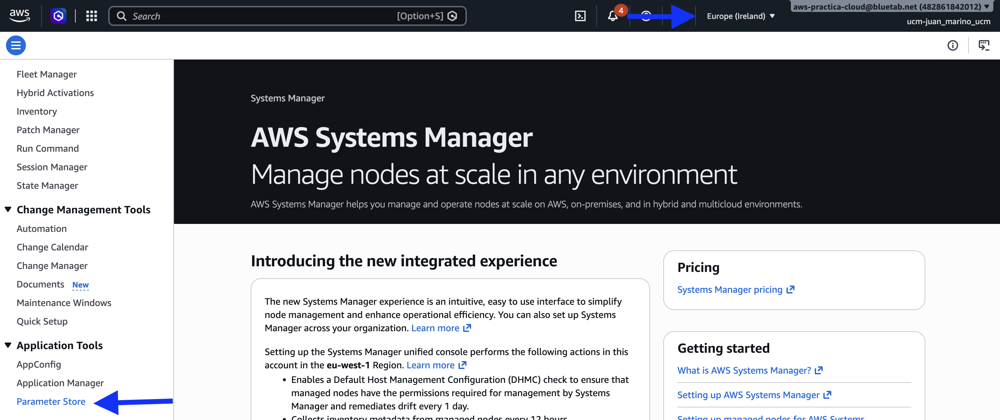

# Petición: publicar la API de menús

Esta carpeta es el mismo proyecto que `plantilla`, con la parte de ECS ya escrita. El primer `apply` deja la aplicación en marcha y devuelve su URL. Después quedan dos bloques: los datos (bucket, catálogo y tablas) y el aviso por correo.

Cada alta de la API escribe un CSV de una sola fila, sin cabecera, en S3. Esos CSV se consultan con Athena. Un fichero nuevo tiene que salir en la consulta siguiente, sin un proceso que lo registre. La imagen ya está en el repositorio ECR `ucm-proyecto-final-fastapi`, etiqueta `latest`, y escucha en el puerto 8000. La región es `eu-west-1`.

## Índice

1. [Primer apply](#primer-apply)
  - [Variables necesarias](#variables-necesarias)
  - [Qué está generado](#qué-está-generado)
  - [Apply inicial tras cambiar las variables](#apply-inicial-tras-cambiar-las-variables)
  - [API Key: dónde localizarla](#api-key-dónde-localizarla)
2. [Tareas pendientes](#tareas-pendientes)
  - [Bloque 1. Datos](#bloque-1--datos)
  - [Bloque 2. Aviso](#bloque-2--aviso)
3. [Arquitectura](#arquitectura)
  - [data.tf](#datatf)
  - [main.tf](#maintf)
  - [datos.tf](#datostf)
  - [aviso.tf](#avisotf)
  - [outputs.tf](#outputstf)
4. [Anexo A. Diagrama detallado](#anexo-a--diagrama-detallado)
5. [Anexo B. Decisiones que infra ya ha tomado](#anexo-b--decisiones-que-infra-ya-ha-tomado)
6. [Anexo C. Límites de la cuenta](#anexo-c--límites-de-la-cuenta)


## Primer apply

Un bloque, un `apply`. El siguiente se empieza cuando el anterior responde. Primero se rellenan las [variables](#variables-necesarias) y se aplica lo que [ya está generado](#qué-está-generado). La salida imprime la URL. Desde ahí se copia la [API Key](#api-key-dónde-localizarla). Los dos bloques de [tareas pendientes](#tareas-pendientes) van después.

La referencia de cada argumento está más abajo, fichero a fichero. Los bloques dicen el tipo de recurso y el orden. El detalle de cada argumento está en la sección del fichero.

### Variables necesarias

Tres variables no tienen valor por defecto. Van en `terraform.tfvars`, en esta carpeta. Terraform lo carga solo, sin `-var-file`, ya que con ese nombre se carga automáticamente. El modelo es `terraform.tfvars.example`: se copia a `terraform.tfvars` y se cambian los tres valores. El `.gitignore` excluye `*.tfvars` y deja el ejemplo, porque el correo es de quien aplica. La API Key no va en este fichero: se copia de Systems Manager, en [Parameter Store](#api-key-dónde-localizarla).

`aws_region`, `imagen_tag` y `numero_tareas` ya tienen valor. Se dejan.

El identificador es el usuario IAM **sin** el prefijo `ucm-`, y **con** el guion bajo. El usuario de la consola `ucm-ana_garcia` se escribe `ana_garcia`. Terraform lo usa para leer el parámetro de prioridad `/ucm/proyecto-final/<identificador>/prioridad`. Si el identificador no es ese, el `plan` falla al leer el parámetro.

A partir de ahí hay dos formas del mismo nombre:


| Dónde                             | Forma                                               | Con `ana_garcia`       |
| --------------------------------- | --------------------------------------------------- | ---------------------- |
| `identificador_alumno`            | Usuario IAM sin `ucm-`. Guion bajo                  | `ana_garcia`           |
| Ruta de la API, clúster, servicio | `ucm-` + el identificador con guiones               | `ucm-ana-garcia`       |
| `bucket_datos`                    | Esa ruta + `-menus`                                 | `ucm-ana-garcia-menus` |
| Base de Glue, en el bloque 1      | `ucm_` + el identificador. En Glue el guion no vale | `ucm_ana_garcia`       |


En S3 el nombre lleva guion. En Glue el nombre lleva guion bajo. El identificador de la variable conserva el guion bajo; cada recurso hace el cambio que le toca. Con `ana_garcia` la ruta sale `ucm-ana-garcia`, el bucket `ucm-ana-garcia-menus` y la base `ucm_ana_garcia`.

`correo_aviso` es un correo que puedas abrir. La validación exige una forma `nombre@dominio.tld`. El primer `apply` todavía no crea la suscripción, pero la variable no tiene default y el `plan` no arranca sin ella. El correo se usa en el bloque 2.

```hcl
identificador_alumno = "ana_garcia"
bucket_datos         = "ucm-ana-garcia-menus"
correo_aviso         = "ana@ejemplo.com"
```


### Qué está generado

En `plantilla` había que declarar el log group, el clúster, la task definition, el target group, la regla del listener y el servicio. Aquí eso ya está en `main.tf`. También está escrita la regla de EventBridge que escucha el clúster (`aviso.tf`): filtra las tareas que pasan a `RUNNING` o a `STOPPED`. El primer `apply` crea esas siete piezas.


| Fichero      | En el primer apply                                                      | Lo escribes tú, después                                                  |
| ------------ | ----------------------------------------------------------------------- | ------------------------------------------------------------------------ |
| `main.tf`    | Log group, clúster, task definition, target group, regla y servicio     |                                                                          |
| `aviso.tf`   | La regla de EventBridge                                                 | Topic, suscripción, log group, zip, Lambda, destino y permiso            |
| `data.tf`    | VPC, subredes, ALB, prioridad, ECR, roles de ECS y el ARN de la API Key | El data source del rol `ucm-lambda-reloj`, en el bloque 2                |
| `datos.tf`   |                                                                         | Bucket, base de Glue y las dos tablas                                    |
| `outputs.tf` | `dns_alb` y `url_api`                                                   | `bucket_datos`, `base_athena` y `funcion_aviso`, al terminar cada bloque |
| `src/aviso/` |                                                                         | El Python no se cambia. Se empaqueta                                     |


La task definition ya lleva el nombre del bucket (`var.bucket_datos`) y el de la base de Glue (`ucm_` más el identificador, con guion bajo). El servicio arranca aunque el bucket y la base todavía no existan. Las consultas funcionan cuando esos nombres coinciden con lo que declares en el bloque 1. Por eso el nombre del bucket se decide ahora, en las variables, y se mantiene.

### Apply inicial tras cambiar las variables

Con `terraform.tfvars` con los calores correctos, inicializar el repositorio y aplicar los cambios.

El `apply` añade 7 recursos: log group, clúster, task definition, target group, regla del listener, servicio y la regla de EventBridge. Al terminar imprime dos salidas. `url_api` es la entrada de la aplicación. El DNS del balanceador es el de la cuenta, el mismo para todo el taller. Lo que cambia de una persona a otra es el tramo `/ucm-<identificador con guiones>/`.



La captura es un `apply` ya hecho: el tramo final es el identificador con guiones. Con `ana_garcia` la URL acaba en `/ucm-ana-garcia/`. La tuya acaba en tu identificador, con los guiones bajos pasados a guion. Podemos visualizar esta información al desplegar al haber generado los outputs correcpondientes. 

El health check tarda uno o dos minutos. Hasta entonces el balanceador puede responder 502 o 503. Cuando el destino está sano:


| Prueba                          | Resultado           |
| ------------------------------- | ------------------- |
| Abrir `url_api` en el navegador | El tablero de menús |
| `url_api` + `health`            | `{"status":"ok"}`   |
| `url_api` + `docs`              | Swagger de la API   |


`terraform output url_api` vuelve a imprimir la URL. El botón **Comprobar** del tablero mira tres cosas. Tras este apply, la API Key de la tarea sale bien: ECS ya la inyecta al arrancar. El bucket y el catálogo de Glue salen mal: se crean en el bloque 1.

### API Key: dónde localizarla

El tablero pide la clave en el campo **API Key**. Cada petición la manda en la cabecera `X-API-Key`. La clave es la misma para todo el taller. Vive en Systems Manager, como SecureString. La task definition guarda el ARN; el valor lo lee ECS al arrancar la tarea. Para escribirla en el formulario hay que copiarla de la consola.

1. En la consola de AWS, la región de arriba a la derecha es **Europe (Ireland)**. Es `eu-west-1`. En otra región el parámetro no sale.
2. Abre **Systems Manager**.
3. En la columna de la izquierda, dentro de **Application Tools**, abre **Parameter Store**.
4. Abre el parámetro `/ucm/proyecto-final/api-key`.
5. Muestra el valor descifrado y pégalo en el campo **API Key** del tablero.



La clave no se copia a `terraform.tfvars` ni al código. Si el campo va vacío, la API responde que la clave está vacía. Si el valor no es el del parámetro, responde que no es correcta.

## Tareas pendientes

El servicio ya atiende. Lo que falta es el sitio donde se guardan los CSV y el correo de arranque y parada. Primero el [bloque 1](#bloque-1--datos), y cuando el tablero guarda y lista, el [bloque 2](#bloque-2--aviso). Cada `apply` enseña solo los recursos de ese bloque.

En cada bloque se declara lo que falta, se quita el `#` de lo que está comentado y se rellena el `TODO: Completar`. Un recurso que ya está escrito no se vuelve a declarar. 

Un bloque comentado no existe para Terraform. `plan` no lo crea y `validate` no lo mira. Se quita el `#` de todo el bloque, no de una sola línea. Lo que ya tiene un valor se deja. Un recurso que no está en el fichero se declara. Uno que ya está escrito no se vuelve a declarar al lado.

En cada recurso, la frase dice para qué sirve y el enlace abre la documentación. La tabla lista los argumentos. Si el argumento ya está en la plantilla, la tabla repite ese valor. Si es un nombre que escribes tú, la tabla pone el patrón `ucm-{vuestro nombre}-...` y el límite: guiones, sin espacios. Si es un número que ya vive en `variables.tf`, la tabla pone el número y toca mirar el fichero. Una frase dice qué pieza usar cuando la referencia la escribes tú. La columna **Para qué** dice qué hace el argumento y por qué el valor es ese.

### Bloque 1 — Datos

Fichero: `datos.tf`. Argumentos de cada recurso: [datos.tf](#datostf).

La API escribe ficheros. S3 los guarda y no sabe qué columnas tienen. Quien ejecuta la consulta es Athena, y Athena lee el esquema en el catálogo de Glue.

**Glue Data Catalog** es el esquema . Una base agrupa las tablas de un alumno. Cada tabla dice el nombre de las columnas, el tipo y la ruta S3 del prefijo (`s3://<bucket>/restaurantes/`). Glue, en este proyecto, no transforma ficheros y no lanza un job. Solo guarda ese catálogo.

**Athena** ejecuta el SQL. Lee el esquema en Glue (forma y localización de la tabla) y los CSV en S3. El workgroup `ucm-proyecto-final` ya existe, con un tope de 100 MB por consulta. Este terraform no crea nada de Athena. La tabla apunta al prefijo y Athena lista los objetos en cada consulta, así que un CSV nuevo entra en la siguiente sin un crawler, sin un rol extra y sin programar nada.


| Orden | Recurso                               | Tipo                                                       | Nombre                                                                                                                                       |
| ----- | ------------------------------------- | ---------------------------------------------------------- | -------------------------------------------------------------------------------------------------------------------------------------------- |
| 1     | `aws_s3_bucket.datos`                 | `resource`. Se declara. No está en el fichero              | `var.bucket_datos`, el de `terraform.tfvars`. `force_destroy = true`                                                                         |
| 2     | `aws_glue_catalog_database.menus`     | `resource`. Se declara. No está en el fichero              | `ucm_` + identificador con guion bajo. Con `ana_garcia`, `ucm_ana_garcia`. Tiene que ser el valor que la tarea ya manda en `ATHENA_DATABASE` |
| 3     | `aws_glue_catalog_table.restaurantes` | `resource`. Está comentada: se descomenta el bloque entero | `restaurantes`. Prefijo `restaurantes/`                                                                                                      |
| 4     | `aws_glue_catalog_table.precios`      | `resource`. Está comentada: se descomenta el bloque entero | `precios`. Prefijo `precios/`                                                                                                                |


En las dos tablas el `storage_descriptor` ya está y se deja. Hay que rellenar `name`, `database_name`, `table_type`, los dos `parameters` y el `type` de cada columna.


| Tabla          | Columna                                   | Tipo        |
| -------------- | ----------------------------------------- | ----------- |
| `restaurantes` | `id`, `nombre`, `descripcion`, `maps_url` | `string`    |
| `precios`      | `id`, `restaurante_id`                    | `string`    |
| `precios`      | `precio`                                  | `double`    |
| `precios`      | `momento`                                 | `timestamp` |


`table_type` es `EXTERNAL_TABLE`: los CSV siguen en S3 y borrar la tabla no borra los objetos. `EXTERNAL` es `TRUE` y `classification` es `csv`.

Después del `apply`, en `outputs.tf` se descomentan `bucket_datos` y `base_athena` y se rellena `value`. En el tablero, **Comprobar** tiene que marcar el bucket y el catálogo de Glue. **Generar datos** escribe tres restaurantes y los vuelve a leer.

### Bloque 2 — Aviso

Ficheros: el rol que falta en `data.tf`, y el resto en `aviso.tf`. Argumentos: [data.tf](#aws_iam_rolelambda) y [aviso.tf](#avisotf).

En el laboratorio 2 la regla de EventBridge era un reloj. Se escribía `schedule_expression = "rate(10 minutes)"` y, pasados diez minutos, la Lambda enviaba el correo hubiera cambiado algo o no.

Aquí el correo sale cuando una tarea de este clúster arranca o se para. La regla ya está en `aviso.tf` y se deja como está. No mide el tiempo: escucha los eventos que ECS publica y se dispara solo si el estado nuevo es `RUNNING` o `STOPPED`.

```hcl
resource "aws_cloudwatch_event_rule" "aviso" {
  name        = "ucm-${replace(var.identificador_alumno, "_", "-")}-aviso"
  description = "Tareas que pasan a RUNNING o STOPPED."

  event_pattern = jsonencode({
    source      = ["aws.ecs"]
    detail-type = ["ECS Task State Change"]
    detail = {
      clusterArn = [aws_ecs_cluster.cluster.arn]
      lastStatus = ["RUNNING", "STOPPED"]
    }
  })
}
```

`source` y `detail-type` fijan el tipo de evento. `clusterArn` lo limita a este clúster. `lastStatus` es el filtro de estados. Quien arranca y para la tarea sigue siendo el servicio ECS: la Lambda publica el cambio, también si alguien para la tarea a mano. Falta lo que hay entre el evento y el buzón.

El mismo encadenado está en el laboratorio 2 del módulo 2: rol leído con un data source, topic y suscripción por correo, `archive_file` para el zip, `aws_lambda_function`, destino de EventBridge y `aws_lambda_permission`. Sirve de modelo, con estos cambios:


| Laboratorio 2                                               | Aquí                                                                                                          |
| ----------------------------------------------------------- | ------------------------------------------------------------------------------------------------------------- |
| `src/reloj/lambda_function.py` y `reloj.zip`                | `src/aviso/lambda_function.py` y `aviso.zip`. El Python no se edita                                           |
| Topic `ucm-...-reloj` y una lista de correos con `for_each` | Un topic `ucm-<id>-aviso` y una suscripción, `endpoint = var.correo_aviso`                                    |
| Regla con `schedule_expression = "rate(10 minutes)"`        | La regla ya está. Escucha `ECS Task State Change` de este clúster                                             |
| Módulo `notificacion_email`                                 | Los recursos se quedan en `aviso.tf`                                                                          |
|                                                             | Log group `/aws/lambda/ucm-<id>-aviso` con 7 días, antes de la Lambda, para que no lo cree ella sin retención |


| Orden | Recurso                             | Tipo                   | Dónde                                                                                                                              |
| ----- | ----------------------------------- | ---------------------- | ---------------------------------------------------------------------------------------------------------------------------------- |
| 1     | `aws_iam_role.lambda`               | `data`. Se declara     | `data.tf`. `name = "ucm-lambda-reloj"`. El rol ya existe; este terraform no crea roles                                             |
| 2     | `aws_sns_topic.aviso`               | `resource`. Se declara | `aviso.tf`. Nombre `ucm-<id con guiones>-aviso`                                                                                    |
| 3     | `aws_sns_topic_subscription.aviso`  | `resource`. Se declara | `protocol = "email"`, `endpoint = var.correo_aviso`                                                                                |
| 4     | `aws_cloudwatch_log_group.aviso`    | `resource`. Se declara | `/aws/lambda/` + el nombre de la función. `retention_in_days = 7`                                                                  |
| 5     | `archive_file.aviso`                | `data`. Se declara     | `type = "zip"`, `source_file` el Python de `src/aviso`, `output_path` `aviso.zip`                                                  |
| 6     | `aws_lambda_function.aviso`         | `resource`. Se declara | El zip, el hash, el rol, `python3.12`, handler `lambda_function.lambda_handler`. Entorno: `IDENTIFICADOR_ALUMNO` y `SNS_TOPIC_ARN` |
| 7     | `aws_cloudwatch_event_rule.aviso`   | `resource`. Ya está    | No se modifica                                                                                                                     |
| 8     | `aws_cloudwatch_event_target.aviso` | `resource`. Se declara | La regla llama a la Lambda                                                                                                         |
| 9     | `aws_lambda_permission.aviso`       | `resource`. Se declara | Sin este permiso la regla existe y la función no se ejecuta                                                                        |


Después del `apply`, en `outputs.tf` se descomenta `funcion_aviso`. SNS manda un correo desde `no-reply@sns.amazonaws.com` con un enlace. Hasta confirmarlo, la suscripción queda en `PendingConfirmation` y el aviso no llega. Conviene mirar el spam.

Para probarlo, con la suscripción confirmada: se para una tarea del servicio. El servicio mantiene `desired_count` en 1 y arranca otra. Llegan dos correos, uno por `STOPPED` y otro por `RUNNING`.

## Arquitectura

Azul: el profesor. Verde: este terraform. Gris: fuera de la cuenta.


La línea continua es el camino de una petición, de una consulta o del aviso. El dibujo pieza a pieza, con la red y los roles, está en el [anexo A](#anexo-a--diagrama-detallado). La columna verde es el proyecto entero. El primer `apply` cubre el clúster, el servicio, la tarea, el log group, el target group y la regla del listener, más la regla de EventBridge. El bucket y las tablas son el bloque 1. La Lambda y el topic son el bloque 2.


| Ya existe                                                       | Lo despliega este Terraform                          |
| --------------------------------------------------------------- | ---------------------------------------------------- |
| VPC, subredes, Internet Gateway, NAT y el endpoint de S3        | Clúster, servicio, tarea y log group `/ecs/ucm-<id>` |
| ALB y su 404 por defecto                                        | Target group y la regla `/ucm-<id>`                  |
| Repositorio ECR y la imagen                                     | Bucket de CSV y tablas de Glue                       |
| Workgroup de Athena                                             |                                                      |
| Roles `ucm-ecs-ejecucion`, `ucm-ecs-tarea` y `ucm-lambda-reloj` | Lambda, topic SNS y regla de EventBridge             |
| Parámetro de prioridad y el SecureString de la API Key          |                                                      |


## [data.tf](http://data.tf)

Se lee lo que ya existe. Estos data sources no crean la VPC, el balanceador, los roles ni el repositorio.

Falta el rol de la Lambda, `aws_iam_role.lambda`. El resto de este fichero ya viene en la plantilla. Lo usa la función de aviso: sin ese data source no hay rol que pasarle.

### `aws_vpc.base`

VPC del taller. Ya está escrito.

Documentación: `[aws_vpc](https://registry.terraform.io/providers/hashicorp/aws/latest/docs/data-sources/vpc)`.


| Argumento   | Valor                    | Para qué                                                                           |
| ----------- | ------------------------ | ---------------------------------------------------------------------------------- |
| `tags.Name` | `ucm-proyecto-final-vpc` | Nombre con el que infra etiquetó la VPC. El data source la selecciona; no la crea. |


### `aws_subnets.privadas`

Subredes privadas de esa VPC. Ya está escrito.

Documentación: `[aws_subnets](https://registry.terraform.io/providers/hashicorp/aws/latest/docs/data-sources/subnets)`.


| Argumento         | Valor                  | Para qué                                                           |
| ----------------- | ---------------------- | ------------------------------------------------------------------ |
| `filter` `vpc-id` | `data.aws_vpc.base.id` | Limita la búsqueda a la VPC del taller.                            |
| `tags.Tier`       | `privada`              | La tarea no lleva IP pública. Solo valen las subredes de ese tier. |


### `aws_security_group.tareas`

Grupo de seguridad de las tareas. Ya está escrito. Solo acepta tráfico del ALB, al puerto 8000.

Documentación: `[aws_security_group](https://registry.terraform.io/providers/hashicorp/aws/latest/docs/data-sources/security_group)`.


| Argumento | Valor                       | Para qué                                                             |
| --------- | --------------------------- | -------------------------------------------------------------------- |
| `name`    | `ucm-proyecto-final-tareas` | Grupo que infra creó para las tareas. El alumno no puede crear otro. |
| `vpc_id`  | `data.aws_vpc.base.id`      | El mismo nombre puede existir en otra VPC. El id acota la búsqueda.  |


### `aws_lb.base`

ALB compartido. Ya está escrito.

Documentación: `[aws_lb](https://registry.terraform.io/providers/hashicorp/aws/latest/docs/data-sources/lb)`.


| Argumento | Valor                    | Para qué                                                                                           |
| --------- | ------------------------ | -------------------------------------------------------------------------------------------------- |
| `name`    | `ucm-proyecto-final-alb` | Nombre del balanceador del taller. Un ALB por servicio se pagaría entero aunque no reciba tráfico. |


### `aws_lb_listener.http`

Listener HTTP de ese ALB. Ya está escrito.

Documentación: `[aws_lb_listener](https://registry.terraform.io/providers/hashicorp/aws/latest/docs/data-sources/lb_listener)`.


| Argumento           | Valor                  | Para qué                                                                                         |
| ------------------- | ---------------------- | ------------------------------------------------------------------------------------------------ |
| `load_balancer_arn` | `data.aws_lb.base.arn` | El listener es de ese ALB. El ARN distingue el puerto 80 de otro listener del mismo balanceador. |
| `port`              | `80`                   | El taller publica HTTP. La regla y la prueba de la API van por ese puerto.                       |


### `aws_ssm_parameter.prioridad`

Prioridad de la regla en el listener. Es un String. Ya está escrito: lo usa `aws_lb_listener_rule.api`.

Documentación: `[aws_ssm_parameter](https://registry.terraform.io/providers/hashicorp/aws/latest/docs/data-sources/ssm_parameter)`.


| Argumento | Valor                                                       | Para qué                                                                                                       |
| --------- | ----------------------------------------------------------- | -------------------------------------------------------------------------------------------------------------- |
| `name`    | `/ucm/proyecto-final/${var.identificador_alumno}/prioridad` | Cada alumno tiene la suya. Dos reglas con la misma prioridad no conviven en el listener, y no se elige a mano. |


### `aws_ecr_repository.fastapi`

Repositorio de la imagen. Ya viene en la plantilla. La task definition lee `repository_url`.

Documentación: `[aws_ecr_repository](https://registry.terraform.io/providers/hashicorp/aws/latest/docs/data-sources/ecr_repository)`.


| Argumento | Valor                        | Para qué                                                                    |
| --------- | ---------------------------- | --------------------------------------------------------------------------- |
| `name`    | `ucm-proyecto-final-fastapi` | Repositorio donde el profesor publicó la imagen. Este terraform no lo crea. |


### `aws_iam_role.ecs_ejecucion`

Rol con el que el agente de ECS baja la imagen, escribe logs e inyecta el secreto. Ya viene en la plantilla. No se puede crear otro rol.

Documentación: `[aws_iam_role](https://registry.terraform.io/providers/hashicorp/aws/latest/docs/data-sources/iam_role)`.


| Argumento | Valor               | Para qué                                                                                                     |
| --------- | ------------------- | ------------------------------------------------------------------------------------------------------------ |
| `name`    | `ucm-ecs-ejecucion` | Rol del agente, no del proceso. `iam:PassRole` del alumno solo vale para este nombre y para `ucm-ecs-tarea`. |


### `aws_iam_role.ecs_tarea`

Rol del proceso de la API, para S3, Athena y Glue. Ya viene en la plantilla.

Documentación: `[aws_iam_role](https://registry.terraform.io/providers/hashicorp/aws/latest/docs/data-sources/iam_role)`.


| Argumento | Valor           | Para qué                                                                                                                                     |
| --------- | --------------- | -------------------------------------------------------------------------------------------------------------------------------------------- |
| `name`    | `ucm-ecs-tarea` | Lo asume el proceso de FastAPI. Separado del de ejecución: la aplicación no puede leer el parámetro del secreto ni reescribir su definición. |


### `aws_iam_role.lambda`

Falta. No está en la plantilla. Se declara. Es el rol de la Lambda de aviso. Lo crea el módulo 0. Publica en topics `ucm-*` y escribe logs de Lambda.

Documentación: `[aws_iam_role](https://registry.terraform.io/providers/hashicorp/aws/latest/docs/data-sources/iam_role)`.


| Argumento | Valor              | Para qué                                                                    |
| --------- | ------------------ | --------------------------------------------------------------------------- |
| `name`    | `ucm-lambda-reloj` | Rol que el módulo 0 dejó para esta función. El alumno no puede crear roles. |


### `aws_ssm_parameter.api_key`

API Key compartida. Es un SecureString. Ya viene en la plantilla. Con `with_decryption = false` Terraform no descifra el parámetro. En la tarea entra el ARN, no el valor.

Documentación: `[aws_ssm_parameter](https://registry.terraform.io/providers/hashicorp/aws/latest/docs/data-sources/ssm_parameter)`.


| Argumento         | Valor                         | Para qué                                                                           |
| ----------------- | ----------------------------- | ---------------------------------------------------------------------------------- |
| `name`            | `/ucm/proyecto-final/api-key` | Parámetro único del taller. El ARN sale de aquí: no hace falta escribir la cuenta. |
| `with_decryption` | `false`                       | El plan no enseña la clave. ECS la lee al arrancar, con el rol de ejecución.       |


## [main.tf](http://main.tf)

Fargate. No EC2 y no un capacity provider. Log group, clúster, task definition, target group, regla y servicio ya vienen en la plantilla.

### `aws_cloudwatch_log_group.api`

Logs del servicio. Ya viene en la plantilla. La retención corta el coste de dejar el grupo creciendo.

Documentación: `[aws_cloudwatch_log_group](https://registry.terraform.io/providers/hashicorp/aws/latest/docs/resources/cloudwatch_log_group)`.


| Argumento           | Valor                                                     | Para qué                                                                                                                 |
| ------------------- | --------------------------------------------------------- | ------------------------------------------------------------------------------------------------------------------------ |
| `name`              | `/ecs/ucm-${replace(var.identificador_alumno, "_", "-")}` | Prefijo que la política de la cuenta deja crear. Un grupo por alumno. El rol de ejecución solo escribe bajo `/ecs/ucm-`. |
| `retention_in_days` | `7`                                                       | CloudWatch no borra un grupo si no se le pone retención. Siete días bastan para mirar un arranque.                       |


### `aws_ecs_cluster.cluster`

Clúster de este terraform. Ya viene en la plantilla. La etiqueta es `cluster`: `[aviso.tf](#avisotf)` usa `aws_ecs_cluster.cluster.arn`. Container Insights se cobra aparte.

Documentación: `[aws_ecs_cluster](https://registry.terraform.io/providers/hashicorp/aws/latest/docs/resources/ecs_cluster)`.


| Argumento       | Valor                                                        | Para qué                                                                                                                 |
| --------------- | ------------------------------------------------------------ | ------------------------------------------------------------------------------------------------------------------------ |
| `name`          | `ucm-${replace(var.identificador_alumno, "_", "-")}-cluster` | Nombre acotado por la política (`ucm-`). La etiqueta del recurso tiene que ser `cluster`: la regla de aviso lee ese ARN. |
| `setting.name`  | `containerInsights`                                          | Único ajuste del clúster que usa esta plantilla.                                                                         |
| `setting.value` | `disabled`                                                   | Container Insights se factura por métrica. El taller no lo usa.                                                          |


### `aws_ecs_task_definition.api`

Definición de la tarea. Ya viene en la plantilla. 0,25 vCPU y 512 MB. El contenedor va en `container_definitions`.

Documentación: `[aws_ecs_task_definition](https://registry.terraform.io/providers/hashicorp/aws/latest/docs/resources/ecs_task_definition)`.


| Argumento                  | Valor                                                    | Para qué                                                                                     |
| -------------------------- | -------------------------------------------------------- | -------------------------------------------------------------------------------------------- |
| `family`                   | `ucm-${replace(var.identificador_alumno, "_", "-")}-api` | Familia de revisiones. Cada cambio publica otra revisión y el servicio apunta a su ARN.      |
| `requires_compatibilities` | `["FARGATE"]`                                            | La definición solo puede correr en Fargate. No hay instancias EC2 que registrar.             |
| `network_mode`             | `awsvpc`                                                 | Obligatorio en Fargate. Cada tarea recibe su ENI, y por eso el target group es de tipo `ip`. |
| `cpu`                      | `256`                                                    | 0,25 vCPU. Es el tamaño mínimo de Fargate que admite 512 MB.                                 |
| `memory`                   | `512`                                                    | Par válido de esas 256 unidades. Cabe en el presupuesto compartido del taller.               |
| `execution_role_arn`       | `data.aws_iam_role.ecs_ejecucion.arn`                    | Lo asume el agente de ECS: baja la imagen, escribe en el log group e inyecta `API_KEY`.      |
| `task_role_arn`            | `data.aws_iam_role.ecs_tarea.arn`                        | Lo asume el proceso de la API para S3, Athena y Glue.                                        |
| `container_definitions`    | Un contenedor, en la tabla siguiente                     | JSON de lo que Fargate arranca. Aquí solo va `fastapi`.                                      |


Contenedor:


| Argumento                    | Valor                                                                 | Para qué                                                                                                      |
| ---------------------------- | --------------------------------------------------------------------- | ------------------------------------------------------------------------------------------------------------- |
| `name`                       | `fastapi`                                                             | El servicio registra el contenedor en el target group por este nombre. Tiene que coincidir en los dos sitios. |
| `image`                      | `${data.aws_ecr_repository.fastapi.repository_url}:${var.imagen_tag}` | URL del repositorio más la etiqueta. El default de `imagen_tag` es `latest`, que publica el profesor.         |
| `essential`                  | `true`                                                                | Si este contenedor sale, la tarea se para. Es el único.                                                       |
| `portMappings.containerPort` | `8000`                                                                | Puerto en el que escucha la imagen. El target group y el grupo de seguridad usan el mismo.                    |
| `portMappings.protocol`      | `tcp`                                                                 | HTTP va sobre TCP. El listener no habla UDP.                                                                  |
| `logConfiguration.logDriver` | `awslogs`                                                             | Driver de CloudWatch. Sin configuración de logs, un fallo de arranque no deja traza.                          |
| `awslogs-group`              | `aws_cloudwatch_log_group.api.name`                                   | Grupo donde escribe. Tiene que existir antes: el rol de ejecución no puede crearlo.                           |
| `awslogs-region`             | `var.aws_region`                                                      | Los logs van a `eu-west-1`, la misma región que el clúster.                                                   |
| `awslogs-stream-prefix`      | `api`                                                                 | En Fargate el driver `awslogs` exige un prefijo. El stream queda como `api/<contenedor>/<id de tarea>`.       |


`environment` lleva un objeto `{ name, value }` por variable. Si falta una, la API no consulta o no arranca bien. El bucket y la base todavía se declaran en `[datos.tf](#datostf)`: aquí ya están los nombres, para no cambiar la tarea cuando se creen.


| Variable                    | Valor                                                 | Para qué                                                                                                                               |
| --------------------------- | ----------------------------------------------------- | -------------------------------------------------------------------------------------------------------------------------------------- |
| `API_ROOT_PATH`             | `/ucm-${replace(var.identificador_alumno, "_", "-")}` | Prefijo de esta API. Tiene que ser el mismo que la regla del listener y que el path del health check.                                  |
| `S3_BUCKET`                 | `var.bucket_datos`                                    | Bucket donde cada alta se escribe como CSV. Es el mismo nombre que llevará `aws_s3_bucket.datos`.                                      |
| `S3_PREFIJO_RESTAURANTES`   | `restaurantes`                                        | Prefijo de esos CSV. La tabla de Glue apunta a `restaurantes/`.                                                                        |
| `S3_PREFIJO_PRECIOS`        | `precios`                                             | Igual para los precios.                                                                                                                |
| `ATHENA_DATABASE`           | `ucm_${replace(var.identificador_alumno, "-", "_")}`  | Base de Glue de este alumno. Con `ana_garcia` sale `ucm_ana_garcia`. La base que se declare tiene que usar este nombre.                |
| `ATHENA_TABLE_RESTAURANTES` | `restaurantes`                                        | Tabla que consulta la API. El nombre es el del recurso de Glue, no el del prefijo por casualidad: tienen que coincidir.                |
| `ATHENA_TABLE_PRECIOS`      | `precios`                                             | Igual para la tabla de precios.                                                                                                        |
| `ATHENA_WORKGROUP`          | `ucm-proyecto-final`                                  | Workgroup que ya existe, con tope de 100 MB por consulta. Este terraform no lo crea.                                                   |
| `ATHENA_OUTPUT`             | `s3://${var.bucket_datos}/consultas/`                 | Athena escribe aquí el resultado. Cada alumno usa su bucket: el workgroup no impone uno común. La barra final forma parte del prefijo. |


`secrets` lleva una entrada. ECS inyecta el valor al arrancar. No queda en la definición.


| Argumento   | Valor                                | Para qué                                                                                       |
| ----------- | ------------------------------------ | ---------------------------------------------------------------------------------------------- |
| `name`      | `API_KEY`                            | Nombre de la variable de entorno que lee la API. Quien llama manda ese valor en la cabecera.   |
| `valueFrom` | `data.aws_ssm_parameter.api_key.arn` | ARN del SecureString. La definición guarda el ARN; el valor lo descifra el agente al arrancar. |


### `aws_lb_target_group.api`

Destinos de la API, por IP, en la VPC del taller. Ya viene en la plantilla. El nombre no pasa de 32 caracteres: con el identificador de como mucho 25, entra.

Documentación: `[aws_lb_target_group](https://registry.terraform.io/providers/hashicorp/aws/latest/docs/resources/lb_target_group)`.


| Argumento                          | Valor                                                        | Para qué                                                                                                                         |
| ---------------------------------- | ------------------------------------------------------------ | -------------------------------------------------------------------------------------------------------------------------------- |
| `name`                             | `ucm-${replace(var.identificador_alumno, "_", "-")}-tg`      | Tope de 32 caracteres. `ucm-`, el identificador en guiones y `-tg` entran si el identificador no pasa de 25.                     |
| `port`                             | `8000`                                                       | Puerto del contenedor. El ALB reenvía aquí.                                                                                      |
| `protocol`                         | `HTTP`                                                       | Mismo protocolo que el listener y que el health check. La API no termina TLS.                                                    |
| `target_type`                      | `ip`                                                         | Con `awsvpc` el destino es la IP de la ENI de la tarea, no una instancia.                                                        |
| `vpc_id`                           | `data.aws_vpc.base.id`                                       | El target group tiene que estar en la misma VPC que las tareas y que el ALB.                                                     |
| `deregistration_delay`             | `30`                                                         | Segundos que el ALB sigue enviando tráfico a un destino que se va. El default son 300; 30 acorta un redespliegue y el `destroy`. |
| `health_check.path`                | `/ucm-${replace(var.identificador_alumno, "_", "-")}/health` | Ruta que responde `{"status":"ok"}`. Lleva el mismo prefijo que `API_ROOT_PATH`: el balanceador no reescribe el path.            |
| `health_check.protocol`            | `HTTP`                                                       | El contenedor no escucha HTTPS.                                                                                                  |
| `health_check.matcher`             | `200`                                                        | Solo un 200 marca el destino como sano. Un 404 lo deja fuera y ECS sustituye la tarea.                                           |
| `health_check.healthy_threshold`   | `2`                                                          | Dos aciertos seguidos y el destino entra. El default es 5; con 2 el servicio se abre antes.                                      |
| `health_check.unhealthy_threshold` | `3`                                                          | Tres fallos y sale. Un timeout suelto no tira la tarea.                                                                          |
| `health_check.timeout`             | `5`                                                          | Segundos de espera de cada prueba. Tiene que ser menor que el intervalo.                                                         |
| `health_check.interval`            | `15`                                                         | Segundos entre pruebas. El default es 30; 15 adelanta el alta. Con dos aciertos, unos 30 s después de que el proceso escuche.    |


### `aws_lb_listener_rule.api`

Reenvía al target group las rutas de este alumno. Ya viene en la plantilla. La prioridad sale del parámetro SSM, no se elige a mano.

Documentación: `[aws_lb_listener_rule](https://registry.terraform.io/providers/hashicorp/aws/latest/docs/resources/lb_listener_rule)`.


| Argumento                 | Valor                                                                                                           | Para qué                                                                                                                           |
| ------------------------- | --------------------------------------------------------------------------------------------------------------- | ---------------------------------------------------------------------------------------------------------------------------------- |
| `listener_arn`            | `data.aws_lb_listener.http.arn`                                                                                 | La regla cuelga del listener 80 del ALB compartido.                                                                                |
| `priority`                | `tonumber(data.aws_ssm_parameter.prioridad.insecure_value)`                                                     | El parámetro es un String. `insecure_value` lo lee sin tratarlo como secreto, y `tonumber` lo pasa al número que exige `priority`. |
| `action.type`             | `forward`                                                                                                       | Reenvía al target group. No responde fijo ni redirige.                                                                             |
| `action.target_group_arn` | `aws_lb_target_group.api.arn`                                                                                   | Destino de ese reenvío. Esta referencia es la que engancha el target group al ALB.                                                 |
| `path_pattern.values`     | `/ucm-${replace(var.identificador_alumno, "_", "-")}` y `/ucm-${replace(var.identificador_alumno, "_", "-")}/*` | La raíz de la API y lo que cuelga de ella.                                                                                         |


Sin la barra del segundo patrón, `/ucm-ana*` también capturaría `/ucm-ana-garcia`. La raíz del ALB, sin esta ruta, sigue respondiendo 404.

### `aws_ecs_service.api`

Servicio Fargate, una tarea, en las subredes privadas. Ya viene en la plantilla. `depends_on` se queda: si el target group no está enganchado al ALB, el servicio no arranca.

Documentación: `[aws_ecs_service](https://registry.terraform.io/providers/hashicorp/aws/latest/docs/resources/ecs_service)`.


| Argumento                                | Valor                                                    | Para qué                                                                                                                                             |
| ---------------------------------------- | -------------------------------------------------------- | ---------------------------------------------------------------------------------------------------------------------------------------------------- |
| `name`                                   | `ucm-${replace(var.identificador_alumno, "_", "-")}-api` | Mismo patrón que la familia. La política de la cuenta acota los servicios bajo `ucm-`.                                                               |
| `cluster`                                | `aws_ecs_cluster.cluster.id`                             | El servicio vive dentro de ese clúster. El id del recurso es el ARN.                                                                                 |
| `task_definition`                        | `aws_ecs_task_definition.api.arn`                        | Revisión que arranca. Si la definición cambia, Terraform publica otra y el servicio la despliega.                                                    |
| `desired_count`                          | `var.numero_tareas`                                      | Número de tareas. En `variables.tf` el default es 1 y la validación rechaza otro valor: el taller comparte subredes y presupuesto.                   |
| `launch_type`                            | `FARGATE`                                                | Sin EC2 ni capacity provider. Encaja con `requires_compatibilities`.                                                                                 |
| `network_configuration.subnets`          | `data.aws_subnets.privadas.ids`                          | Una ENI en las subredes privadas. Sale a ECR y al resto de AWS por el NAT y por el endpoint de S3.                                                   |
| `network_configuration.security_groups`  | `[data.aws_security_group.tareas.id]`                    | Solo entra tráfico del ALB, al puerto 8000.                                                                                                          |
| `network_configuration.assign_public_ip` | `false`                                                  | La tarea no se publica. En una subred privada una IP pública no tiene ruta de vuelta por el Internet Gateway.                                        |
| `load_balancer.target_group_arn`         | `aws_lb_target_group.api.arn`                            | ECS registra la IP de la tarea en este target group.                                                                                                 |
| `load_balancer.container_name`           | `fastapi`                                                | Tiene que ser el `name` del contenedor. Si no coincide, el servicio no sabe qué IP registrar.                                                        |
| `load_balancer.container_port`           | `8000`                                                   | Puerto que el target group sondea.                                                                                                                   |
| `depends_on`                             | `[aws_lb_listener_rule.api]`                             | CreateService exige que el target group ya esté asociado a un balanceador. Esa asociación la crea la regla. Terraform no la infiere solo con el ARN. |


## [datos.tf](http://datos.tf)

Bloque 1. El orden y el tipo de cada recurso están en [Bloque 1 — Datos](#bloque-1--datos).

El workgroup `ucm-proyecto-final` ya existe. Este terraform no lo crea. El tope del workgroup y por qué no hay crawler están en el [anexo B](#anexo-b--decisiones-que-infra-ya-ha-tomado).

El bucket y la base se declaran. Las dos tablas están comentadas. Cada CSV es una fila, sin cabecera. La tabla apunta al prefijo y Athena lista los objetos.

La task definition ya usa `var.bucket_datos` y `ucm_${replace(var.identificador_alumno, "-", "_")}`. El bucket y la base tienen que salir con esos nombres.

### `aws_s3_bucket.datos`

Bucket de los CSV. No está en la plantilla. Se declara. En `terraform.tfvars`, `bucket_datos` es `ucm-<id>-menus`. `force_destroy` en `true` permite el `destroy` cuando ya hay objetos.

Documentación: `[aws_s3_bucket](https://registry.terraform.io/providers/hashicorp/aws/latest/docs/resources/s3_bucket)`.


| Argumento       | Valor                   | Para qué                                                                                         |
| --------------- | ----------------------- | ------------------------------------------------------------------------------------------------ |
| `bucket`        | Variable `bucket_datos` | Nombre global del bucket. La tarea ya lo tiene en `S3_BUCKET` y en `ATHENA_OUTPUT`.              |
| `force_destroy` | `true`                  | Un bucket con objetos no se puede destruir. Con esto, `terraform destroy` borra también los CSV. |


### `aws_glue_catalog_database.menus`

Base de Glue de este alumno. No está en la plantilla. Se declara.

Documentación: `[aws_glue_catalog_database](https://registry.terraform.io/providers/hashicorp/aws/latest/docs/resources/glue_catalog_database)`.


| Argumento | Valor                                                | Para qué                                                                                                                 |
| --------- | ---------------------------------------------------- | ------------------------------------------------------------------------------------------------------------------------ |
| `name`    | `ucm_${replace(var.identificador_alumno, "-", "_")}` | Glue no admite el guion. Con `ana_garcia` sale `ucm_ana_garcia`. Es el valor que la tarea ya manda en `ATHENA_DATABASE`. |


### `aws_glue_catalog_table.restaurantes`

Tabla externa del prefijo `restaurantes/`. Está comentada. El `storage_descriptor` ya está: ubicación con barra final, `LazySimpleSerDe`, separador coma y sin comillas. No se reescribe. Falta el `type` de cada columna. El nombre de la columna ya está.

Documentación: `[aws_glue_catalog_table](https://registry.terraform.io/providers/hashicorp/aws/latest/docs/resources/glue_catalog_table)`.


| Argumento                   | Valor                     | Para qué                                                                                                                               |
| --------------------------- | ------------------------- | -------------------------------------------------------------------------------------------------------------------------------------- |
| `name`                      | `restaurantes`            | Nombre que Athena usa en el `FROM`. La tarea ya lo manda en `ATHENA_TABLE_RESTAURANTES`.                                               |
| `database_name`             | Nombre de la base de Glue | La tabla cuelga de la base de este alumno, no del catálogo por defecto.                                                                |
| `table_type`                | `EXTERNAL_TABLE`          | Los datos están en S3. Glue solo guarda el esquema y la ubicación.                                                                     |
| `parameters.EXTERNAL`       | `TRUE`                    | Marca que Hive y Athena tratan la tabla como externa. Sin esto, una herramienta puede intentar borrar los ficheros al borrar la tabla. |
| `parameters.classification` | `csv`                     | Athena clasifica el objeto como CSV. Encaja con el serde y con el fichero de una fila.                                                 |
| `columns` `id`              | `string`                  | Identificador del restaurante, tal como lo escribe la API.                                                                             |
| `columns` `nombre`          | `string`                  | Nombre del restaurante. Texto, sin comas: el separador es la coma y el fichero no lleva comillas.                                      |
| `columns` `descripcion`     | `string`                  | Texto libre del restaurante. Misma limitación con las comas.                                                                           |
| `columns` `maps_url`        | `string`                  | URL de mapa. Va como texto.                                                                                                            |


### `aws_glue_catalog_table.precios`

Tabla externa del prefijo `precios/`. Está comentada. El `storage_descriptor` ya está y no se reescribe.

Documentación: `[aws_glue_catalog_table](https://registry.terraform.io/providers/hashicorp/aws/latest/docs/resources/glue_catalog_table)`.


| Argumento                   | Valor                     | Para qué                                                                                                       |
| --------------------------- | ------------------------- | -------------------------------------------------------------------------------------------------------------- |
| `name`                      | `precios`                 | Nombre de la tabla. La tarea ya lo manda en `ATHENA_TABLE_PRECIOS`.                                            |
| `database_name`             | Nombre de la base de Glue | La misma base que la de restaurantes.                                                                          |
| `table_type`                | `EXTERNAL_TABLE`          | Los CSV siguen en S3. Borrar la tabla no borra los objetos.                                                    |
| `parameters.EXTERNAL`       | `TRUE`                    | Misma marca que en restaurantes, para que el catálogo no tome la tabla como gestionada.                        |
| `parameters.classification` | `csv`                     | El objeto es un CSV de una fila.                                                                               |
| `columns` `id`              | `string`                  | Identificador de la fila de precio.                                                                            |
| `columns` `restaurante_id`  | `string`                  | Identificador del restaurante al que pertenece el precio. La consulta lo usa para unir las dos tablas.         |
| `columns` `precio`          | `double`                  | Importe. La API lo escribe con dos decimales (`12.50`) y este serde lo lee como `double`.                      |
| `columns` `momento`         | `timestamp`               | Instante del precio, en UTC, como `2026-10-16 09:22:00`. Es el formato que este serde acepta como `timestamp`. |


`precio` se escribe con dos decimales (`12.50`). `momento` se escribe en UTC como `2026-10-16 09:22:00`, que es el formato que este serde lee como `timestamp`. Un campo de texto no puede llevar comas: el separador es la coma y el fichero no usa comillas.

## [aviso.tf](http://aviso.tf)

Bloque 2. El orden, el tipo de cada recurso y el paralelo con el laboratorio 2 están en [Bloque 2 — Aviso](#bloque-2--aviso).

La Lambda publica en SNS cuando una tarea de este clúster pasa a `RUNNING` o a `STOPPED`. También si alguien la para a mano. No hay horario. La regla ya está. El resto se declara. El rol es `[aws_iam_role.lambda](#aws_iam_rolelambda)`.

### `aws_sns_topic.aviso`

Topic del correo. No está en la plantilla. Se declara.

Documentación: `[aws_sns_topic](https://registry.terraform.io/providers/hashicorp/aws/latest/docs/resources/sns_topic)`.


| Argumento | Valor                                               | Para qué                                                                             |
| --------- | --------------------------------------------------- | ------------------------------------------------------------------------------------ |
| `name`    | `ucm-{vuestro nombre}-aviso`. Guiones, sin espacios | La política acota los topics bajo `ucm-`. El sufijo `-aviso` lo separa del servicio. |


### `aws_sns_topic_subscription.aviso`

Suscripción al topic. No está en la plantilla. Se declara. SNS no entrega nada hasta que se confirma el enlace.

Documentación: `[aws_sns_topic_subscription](https://registry.terraform.io/providers/hashicorp/aws/latest/docs/resources/sns_topic_subscription)`.


| Argumento   | Valor                  | Para qué                                                                                  |
| ----------- | ---------------------- | ----------------------------------------------------------------------------------------- |
| `topic_arn` | ARN del topic de aviso | Suscripción de ese topic, no de otro.                                                     |
| `protocol`  | `email`                | SNS manda un correo con un enlace. Hasta confirmarlo, la suscripción existe y no entrega. |
| `endpoint`  | Correo del aviso       | `var.correo_aviso`. La validación de la variable exige un correo con forma válida.        |


### `aws_cloudwatch_log_group.aviso`

Logs de la función. No está en la plantilla. Se declara. El nombre tiene que existir antes que la Lambda: si no, Lambda crea el grupo sin retención.

Documentación: `[aws_cloudwatch_log_group](https://registry.terraform.io/providers/hashicorp/aws/latest/docs/resources/cloudwatch_log_group)`.


| Argumento           | Valor                                                           | Para qué                                                                                                               |
| ------------------- | --------------------------------------------------------------- | ---------------------------------------------------------------------------------------------------------------------- |
| `name`              | `/aws/lambda/ucm-{vuestro nombre}-aviso`. Guiones, sin espacios | Lambda escribe en `/aws/lambda/<nombre de la función>`. Si el grupo no existe, lo crea ella y sin `retention_in_days`. |
| `retention_in_days` | `7`                                                             | Misma retención que el servicio. El aviso no necesita más historial.                                                   |


### `archive_file.aviso`

Zip del Python. No está en la plantilla. Se declara. El fichero no se edita.

Documentación: `[archive_file](https://registry.terraform.io/providers/hashicorp/archive/latest/docs/data-sources/archive_file)`.


| Argumento     | Valor                                         | Para qué                                                                                                                 |
| ------------- | --------------------------------------------- | ------------------------------------------------------------------------------------------------------------------------ |
| `type`        | `zip`                                         | Formato que acepta `aws_lambda_function` en `filename`.                                                                  |
| `source_file` | `${path.module}/src/aviso/lambda_function.py` | El Python de esta carpeta. `path.module` es la carpeta del terraform, no el directorio desde el que se lanza el comando. |
| `output_path` | `${path.module}/aviso.zip`                    | Zip que lee la función. El `.gitignore` lo excluye: se regenera en el `plan`.                                            |


### `aws_lambda_function.aviso`

Función que publica el correo. No está en la plantilla. Se declara. `memory_size` se deja sin poner: el default es 128 MB. Sin `source_code_hash`, un cambio en el Python no se despliega. El Python lee `IDENTIFICADOR_ALUMNO` y `SNS_TOPIC_ARN`.

Documentación: `[aws_lambda_function](https://registry.terraform.io/providers/hashicorp/aws/latest/docs/resources/lambda_function)`.


| Argumento                                    | Valor                                               | Para qué                                                                                                                 |
| -------------------------------------------- | --------------------------------------------------- | ------------------------------------------------------------------------------------------------------------------------ |
| `function_name`                              | `ucm-{vuestro nombre}-aviso`. Guiones, sin espacios | Nombre de la función. El log group usa el mismo, bajo `/aws/lambda/`.                                                    |
| `role`                                       | Rol `lambda`                                        | `data.aws_iam_role.lambda.arn`. Publica en topics `ucm-*` y escribe sus logs.                                            |
| `filename`                                   | Ruta del zip                                        | `archive_file.aviso.output_path`. Sin zip no hay código que invocar.                                                     |
| `source_code_hash`                           | Hash del zip                                        | `archive_file.aviso.output_base64sha256`. Si el Python cambia y este hash no está, Terraform no publica el código nuevo. |
| `handler`                                    | `lambda_function.lambda_handler`                    | Fichero `lambda_function` (el del zip, sin `.py`) y función `lambda_handler`.                                            |
| `runtime`                                    | `python3.12`                                        | Runtime del Python que está en `src/aviso`. Uno distinto no encuentra el intérprete que espera ese código.               |
| `timeout`                                    | `10`                                                | Segundos. Publicar en SNS es una llamada corta. El default son 3; 10 cubre un reintento breve.                           |
| `environment.variables.IDENTIFICADOR_ALUMNO` | Identificador del alumno                            | El correo dice de quién es la tarea. Es `var.identificador_alumno`.                                                      |
| `environment.variables.SNS_TOPIC_ARN`        | ARN del topic de aviso                              | Destino del publish. El rol permite topics `ucm-*`; el ARN concreta cuál.                                                |
| `depends_on`                                 | Log group de la función                             | Orden de creación. Sin esto, Lambda puede ganar la carrera y crear el grupo sin retención.                               |


### `aws_cloudwatch_event_rule.aviso`

Regla que escucha el cambio de estado de las tareas de este clúster. Ya está escrita. El patrón no se cambia.

Documentación: `[aws_cloudwatch_event_rule](https://registry.terraform.io/providers/hashicorp/aws/latest/docs/resources/cloudwatch_event_rule)`.


| Argumento       | Valor                                                                                   | Para qué                                                                                                                                                          |
| --------------- | --------------------------------------------------------------------------------------- | ----------------------------------------------------------------------------------------------------------------------------------------------------------------- |
| `name`          | `ucm-${replace(var.identificador_alumno, "_", "-")}-aviso`                              | Mismo nombre que el topic y que la función. La política acota el nombre bajo `ucm-`.                                                                              |
| `description`   | `Tareas que pasan a RUNNING o STOPPED.`                                                 | Texto en la consola. No filtra eventos.                                                                                                                           |
| `event_pattern` | Tareas de este clúster que pasan a `RUNNING` o `STOPPED`. El JSON ya está en el recurso | `clusterArn` es el de `aws_ecs_cluster.cluster`. Así el aviso no salta por la tarea de otro alumno. No hay horario: también vale si alguien para la tarea a mano. |


### `aws_cloudwatch_event_target.aviso`

Destino de la regla. No está en la plantilla. Se declara. Sin esto, la regla existe y no llama a la función.

Documentación: `[aws_cloudwatch_event_target](https://registry.terraform.io/providers/hashicorp/aws/latest/docs/resources/cloudwatch_event_target)`.


| Argumento | Valor                       | Para qué                                                         |
| --------- | --------------------------- | ---------------------------------------------------------------- |
| `rule`    | Nombre de la regla de aviso | Engancha el destino a esa regla.                                 |
| `arn`     | ARN de la función           | EventBridge invoca esa Lambda con el evento de cambio de estado. |


### `aws_lambda_permission.aviso`

Permiso para que EventBridge invoque la función, limitado a esta regla. No está en la plantilla. Se declara. Sin el permiso, el target no llega a ejecutarse.

Documentación: `[aws_lambda_permission](https://registry.terraform.io/providers/hashicorp/aws/latest/docs/resources/lambda_permission)`.


| Argumento       | Valor                           | Para qué                                                                                                      |
| --------------- | ------------------------------- | ------------------------------------------------------------------------------------------------------------- |
| `statement_id`  | `AllowExecutionFromEventBridge` | Id de la sentencia dentro de la política de la función. Una segunda sentencia con el mismo id pisa esta.      |
| `action`        | `lambda:InvokeFunction`         | Lo único que EventBridge necesita hacer con la función.                                                       |
| `principal`     | `events.amazonaws.com`          | Servicio que invoca. Otro principal no cubre EventBridge.                                                     |
| `function_name` | Nombre de la función            | Función que recibe el permiso.                                                                                |
| `source_arn`    | ARN de la regla de aviso        | Limita la invocación a esta regla. Sin `source_arn`, cualquier regla de la cuenta podría llamar a la función. |


## [outputs.tf](http://outputs.tf)

`dns_alb` y `url_api` ya vienen en la plantilla. Sirven para entrar. Las otras tres salidas están comentadas. La `description` ya está. Se rellena `value`.

### `dns_alb`

DNS del ALB compartido. Ya viene en la plantilla.


| Argumento | Valor                       | Para qué                                                                                      |
| --------- | --------------------------- | --------------------------------------------------------------------------------------------- |
| `value`   | `data.aws_lb.base.dns_name` | Nombre DNS del balanceador. La API no tiene un DNS propio: se entra por este, con el prefijo. |


### `url_api`

URL de la API, con el prefijo de este alumno. Ya viene en la plantilla.


| Argumento | Valor                                                                                     | Para qué                                                                                                          |
| --------- | ----------------------------------------------------------------------------------------- | ----------------------------------------------------------------------------------------------------------------- |
| `value`   | `http://${data.aws_lb.base.dns_name}/ucm-${replace(var.identificador_alumno, "_", "-")}/` | Entrada de la aplicación. `terraform output url_api` la imprime. La documentación es esa URL con `docs` al final. |


### `bucket_datos`

Nombre del bucket de CSV.


| Argumento | Valor                      | Para qué                                                                                                       |
| --------- | -------------------------- | -------------------------------------------------------------------------------------------------------------- |
| `value`   | Nombre del bucket de datos | Para copiar objetos y para comprobar que el nombre es el de `S3_BUCKET`. Sale de `aws_s3_bucket.datos.bucket`. |


### `base_athena`

Nombre de la base de Glue.


| Argumento | Valor                     | Para qué                                                                                                                 |
| --------- | ------------------------- | ------------------------------------------------------------------------------------------------------------------------ |
| `value`   | Nombre de la base de Glue | Para abrir la base en Athena. Tiene que coincidir con `ATHENA_DATABASE`. Sale de `aws_glue_catalog_database.menus.name`. |


### `funcion_aviso`

Nombre de la función Lambda del aviso.


| Argumento | Valor                         | Para qué                                                                                          |
| --------- | ----------------------------- | ------------------------------------------------------------------------------------------------- |
| `value`   | Nombre de la función de aviso | Para mirar los logs en `/aws/lambda/<nombre>`. Sale de `aws_lambda_function.aviso.function_name`. |


### Cierre

La documentación es `url_api` con `docs` al final. La prioridad se ve en el plan de la regla.


| Prueba                           | Resultado                                     |
| -------------------------------- | --------------------------------------------- |
| `GET /ucm-<id>/health` en el ALB | `{"status":"ok"}`                             |
| `GET /ucm-<id>/`                 | responde la API, con el identificador         |
| `GET /ucm-<id>/docs`             | Swagger de la API                             |
| `GET /`                          | `404` y el texto `Ruta no encontrada`         |
| Arrancar o parar una tarea       | correo, después de confirmar el enlace de SNS |


El servicio tarda uno o dos minutos en pasar el health check.

Al terminar se destruye lo desplegado en este terraform: clúster, servicio, target group, regla, bucket, tablas, Lambda, topic y log groups. El ALB, la red, los roles y el repositorio los retira infra. Una regla o un target group que se queden hacen fallar ese retiro.

## Anexo A — Diagrama detallado

Azul: ya está desplegado. Verde: lo despliega este terraform. Gris: fuera de la cuenta. La línea continua es tráfico. La discontinua es un rol, la prioridad o el aviso.

`id` es el identificador con los guiones bajos pasados a guion (`ana_garcia` → `ana-garcia`). En Glue el guion pasa a guion bajo (`ucm_ana_garcia`).


La petición entra por el ALB compartido. La tarea vive en subredes privadas, sin IP pública. El rol de ejecución inyecta `API_KEY` al arrancar. La Lambda publica el cambio de estado. La tabla de Glue apunta al prefijo y Athena lista los CSV en cada consulta.

## Anexo B — Decisiones que infra ya ha tomado

Estas decisiones no se negocian. El terraform se apoya en ellas.

**Un ALB para todos.** Un balanceador por servicio se paga entero aunque no reciba tráfico. El listener responde 404 a cualquier ruta sin regla, así un prefijo mal escrito no entra en el servicio de otro. La regla de cada uno lleva una prioridad distinta: el parámetro SSM la asigna infra, porque dos reglas con la misma prioridad no conviven en el listener. La posición en la lista de alumnos, por diez, deja hueco entre medias. Quitar a alguien del medio cambia la prioridad de los siguientes.

**La tarea no tiene IP pública.** Vive en subredes privadas. El grupo de seguridad solo acepta tráfico del ALB, al puerto 8000, y solo sale por el 443. Hay un solo NAT para toda la cuenta de prácticas: en producción sería uno por zona, y aquí el segundo no aporta y sí se paga. El endpoint de S3 es de tipo gateway y no se factura: las capas de ECR se descargan de S3 y no cruzan el NAT.

**Dos roles, y ninguno lo crea este terraform.** El de ejecución lo usa el agente de ECS para bajar la imagen, escribir logs e inyectar el secreto al arrancar. El de la tarea lo usa el proceso de la API para S3, Athena y Glue. Separarlos evita que la aplicación pueda leer el parámetro del secreto o reescribir su propia definición. El rol de la Lambda es el del módulo 0: publica en topics `ucm-`* y escribe sus logs.

**La API Key no está en el código ni en la definición.** Es un SecureString. La definición guarda el ARN. ECS lee el valor al arrancar la tarea y lo pasa como `API_KEY`. Quien mire la task definition ve el ARN, no la clave.

**Un workgroup de Athena, con tope.** `bytes_scanned_cutoff_per_query` está en 100 MB para que una consulta mal escrita no recorra de más. `enforce_workgroup_configuration` está en false: si estuviera en true, Athena ignoraría el bucket de resultados que manda cada servicio y exigiría el del workgroup. Cada uno escribe los resultados en su bucket, bajo `consultas/`.

**Sin crawler.** La tabla apunta al prefijo y declara las columnas. Athena lista los objetos en cada consulta, así que un CSV nuevo entra sin lanzar nada, sin un rol extra y sin el coste de una ejecución del crawler. El crawler, además, inferiría el esquema a su manera.

**El estado es local.** `versions.tf` no lleva bloque `backend`. Terraform escribe `terraform.tfstate` en esta carpeta. El `.gitignore` lo excluye, igual que `terraform.tfstate.backup`. Es un solo entorno: un directorio, un `terraform.tfvars` y un estado. Dos `apply` a la vez no escriben los dos: el segundo se para al ver `.terraform.tfstate.lock.info`. Si el proceso murió y el lock sigue, `terraform force-unlock` suelta el id del error. No se borra el estado. `.terraform.lock.hcl` es el lock del provider: fija la versión que bajó `init`. `force-unlock` no lo abre.

**El aviso no programa el horario.** Infra no ha pedido apagar el servicio a una hora. El evento sale cuando la tarea cambia de estado, también si alguien la para a mano. Confirmar el correo de SNS es parte del cierre: hasta entonces la suscripción no entrega.

## Anexo C — Límites de la cuenta

El usuario con el que se aplica no puede crear roles ni grupos de seguridad. `iam:PassRole` solo vale para `ucm-ecs-ejecucion` y `ucm-ecs-tarea`, y solo hacia `ecs-tasks.amazonaws.com`.

Los nombres que se creen tienen que poder acotarse: clústeres, servicios, target groups, topics y buckets bajo `ucm-`, log groups del servicio bajo `/ecs/ucm-`, bases de Glue bajo `ucm_`. Las reglas del listener no llevan nombre en el ARN. La política deja crearlas en el listener del taller.